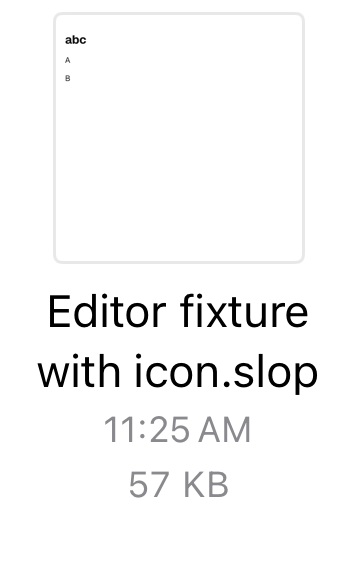

# iPhone local editor proof

> Historical phase-one evidence retained from PR #47 before its checkpoint update.
> These results describe the earlier local-editor builds and provisional iOS 18 target.
> The current iOS 26 preview and CloudKit library are described in the roadmap.

## Delivery and retained work

- One checkout, sequential branches from fetched master.
- Earlier iCloud pause work: local commit `402944e947a91d2a8cb04dcbe0c4f3596bb71814` on `wip/icloud-file-support-before-ios`; named stash `93177537d664a709f1382a3babc123eacc0a4707` also retained. Ignored publication and CloudKit spikes remain on disk.
- Mac save fix: commit `9259d6bf`, [draft PR #46](https://github.com/hitSlop/hitSlop/pull/46). Full native verification and frozen compatibility replay passed before switching branches.
- This branch starts from `origin/master` at `67bf4de4`. It proves the local editor before adding CloudKit.

## What this proof builds

- iOS 18+ device and simulator builds of the existing Rust owner and SQLite storage. The FFI retains one interface; desktop process execution and socket hosting have explicit unavailable implementations in the mobile graph.
- UIKit adapters around the same DocumentOwner, DocumentSession, page shell, resource handler and page authorization checks.
- A private local document list, Files import, data/theme edits, undo/redo, attachments and saved .slop export. Imports preserve the source and create an independent document identity through the Rust file layer.
- A Quick Look thumbnail extension for the iPhone Files app, sharing the Mac provider. It reads saved icon PNGs through Rust, falls back to saved preview artwork and never runs authored code.
- The existing async autosave policy. Inactive/background scenes request a page drain and durable flush within finite OS background time. Expiration does not discard state or imply that persistence completed.
- An isolated preview bundle (`com.hitslop.iospreview`), without CloudKit entitlements. Camera, microphone, speech, widgets, capture and authored file downloads are outside this proof; refusal behavior must remain explicit.

## Acceptance and evidence

Run `bun scripts/build/ios.ts` to build the three framework slices, prepare minimal host fixtures and unchanged released documents, and generate the Xcode project. Use the `hitSlop-iOS` scheme for simulator/device tests.

The proof must open and render real .slop files, edit data and theme, persist attachments, save/reopen, and produce an export that the Mac core accepts. The user prioritized the happy path on the physical iPhone and deferred further simulator and robustness investigation. Record actual device/OS, build identity, save latency, memory, termination/background behavior, keyboard/rotation and Files picker coverage. Do not substitute simulator evidence for physical-device results.

The portable Rust/UniFFI graph passed `cargo check --locked -p hitslop-core-ffi --target aarch64-apple-ios --no-default-features`. `bun scripts/build/ios.ts` produced macOS, iPhone and simulator framework slices without changing persisted format markers or any frozen corpus artifact. Ordinary `bun run verify` passed in 574.2 seconds and the first `bun run verify --native` passed in 565.0 seconds. After the exported-artwork fix, full native verification passed in **818.5 seconds**, including all 404 Rust tests, Swift integration and unchanged released-document compatibility replay.

The final `bun run verify app` passed in **269.3 seconds**, covering the complete Mac app, installed commands, packaged compatibility replay, bundled starters, rendering/export and matching core build identities. An earlier run correctly rejected mixed build identities because the core was rebuilt during app assembly; the successful final run used stable artifacts.

| Runtime | Evidence | Result |
| --- | --- | --- |
| iPhone 16 simulator, iOS 18.0 | `/private/tmp/hitslop-ios18-final-proof.xcresult` | Three tests passed: real-page data/theme/attachment/save/export/reopen; eight released-document render/theme/export/reopen cases; keyboard, rotation, background/foreground, restart and Files export UI |
| iPhone 14 Pro, iOS 26.6.1 | `/private/tmp/hitslop-iphone-proof-2.xcresult` | Both owner/page tests passed, including all eight released documents. The UI test in this run stopped at an ambiguous Done selector; the keyboard had its own Done button |
| Same physical iPhone, corrected selector | `/private/tmp/hitslop-iphone-ui-proof.xcresult` | UI test passed in 28.4 seconds, including keyboard, rotation, background/foreground, closed-document restart and Files export |
| Same physical iPhone, Files artwork fix | `/private/tmp/hitslop-iphone-artwork-fix.xcresult` | All four tests passed: data/theme/attachments/export/reimport, all eight released documents, system thumbnail generation without file modification, and keyboard/rotation/background/active-owner termination/restart/Files import-export. The actual Files cell screenshot shows the saved artwork |
| Same physical iPhone, final UI check | `/private/tmp/hitslop-iphone-final-ui.xcresult` | Passed in 39.9 seconds: keyboard, rotation, background, active-owner termination/restart, Files export/import and the actual custom thumbnail in Files |
| iOS 18.0 simulator, artwork fix | `/private/tmp/hitslop-ios18-artwork-fix.xcresult`; UI retry `/private/tmp/hitslop-ios18-files-dismissal.xcresult` | Editor, eight released documents and system thumbnail tests passed. The Files UI run did not return to a hittable editor Done button after export; further investigation is deferred, so the final minimum-OS Files flow remains unqualified |
| Mac core reads iPhone exports | `/private/tmp/hitslop-phone-mac-proof.log` | All nine exports accepted. The core read the new `#cc4488` theme and the exact 16-byte attachment; all eight released-document exports remained openable |

Initial core build identity: `a82eb2e05aa8abaf`; the artwork fix is `163ff6f0c5d969a4`. The initial device test's ten small-fixture page-drain-and-durable-flush samples had median **5.50 ms**, maximum **7.82 ms**. These are warm end-to-end samples, not isolated fullfsync measurements or a large-document benchmark. Host resident memory after saves was **130.2 MiB**; this excludes WebKit's separate processes. The sanitized report is retained locally at `.hitslop/evidence/ios-local-editor/physical-report.json`.

### Files icons and export semantics

The user correctly reported that Files still displayed a generic document icon even though the system thumbnail API test passed. Direct inspection found that the prototype's `session.copy` path intentionally erased artwork: Mac Share a Copy supplies freshly rendered artwork, while the iPhone proof has no capture renderer. The focused device regression `/private/tmp/hitslop-iphone-export-icon-regression.xcresult` failed at `Files exports must retain the document icon` before the fix.

The iPhone action is now **Export File**, using the existing Rust owner Backup operation through UniFFI. It flushes and durably publishes the full saved document, including identity, history and last saved artwork. The button's accessibility hint describes those contents. This is distinct from Mac **Share a Copy**, which still creates a fresh identity, removes history/unreferenced attachments and drops stale artwork unless freshly rendered artwork is supplied. That sanitization is unchanged.

Files import preserves the input's history and saved artwork but assigns a fresh identity and clears relay membership. It never changes the input. Normal local save/close retention still applies to the imported document. A shared-boundary Rust test covers independent identity, preserved artwork, cleared membership, collision refusal and unchanged source bytes.

The iOS exported type declaration now agrees with the Mac (`com.hitslop.slop`, conforming to both `public.data` and `public.content`), so Files enables the document for import and routes thumbnail requests correctly. The thumbnail extension is embedded in the preview bundle, with no CloudKit entitlement. Earlier exports without embedded artwork do not repair themselves.

Fresh artwork after edits remains M1 work: the proof exports **last saved artwork**, rather than running authored capture in the thumbnail extension or the native app process. Full-file export is not a privacy-sanitized sharing operation. Revisit the export choices before adding shared library documents; never silently weaken the Mac clean-copy contract or create a second active sync path.

Actual Files cell on the physical iPhone after the fix (minimal infrastructure fixture, not a shipped template):

The first iOS 18.5 simulator attempt stopped before app launch because that installed runtime did not locate `libswiftWebKit.dylib`; Apple documents the [runtime issue](https://developer.apple.com/forums/thread/785964). Testing the installed 18.0 runtime proved the actual minimum without production linker workarounds. The initial corpus packaging incorrectly skipped symlinked release directories; it now follows directory links and copies the immutable documents into the disposable test bundle. The corrected complete corpus run passed on both runtimes above.

This is a viability proof. It does not qualify automatic cloud delivery, large-document capacity, prolonged suspension, background-expiration races, every Files provider or platform services. Production M1 still needs the bundled templates, error presentation and service coverage below. The fixture is minimal infrastructure and is included only in the test bundle, never in the app.

## Minimum OS decision

The user permits raising either minimum if it removes meaningful complexity. Keep macOS 15.2 and iOS 18.0 as provisional deployment targets for this proof: the existing owner, WebKit bridge, file coordination, secure file import and CloudKit transport do not need a newer OS. The minimum-iOS simulator passed the real-page and complete corpus tests. The final Files UI flow is qualified on the physical iPhone running 26.6.1; investigate the iOS 18 dismissal issue before claiming production support for that flow on the minimum OS. The user prioritized the physical-device happy path and deferred further robustness investigation.

- CKSyncEngine needs only iOS 17/macOS 14 ([Apple sample](https://github.com/apple/sample-cloudkit-sync-engine)). Raising to 26 does not simplify its durable outbox, account isolation, key delivery or document merging.
- iOS 18.4 adds the WKUIDelegate file-input override. The sole availability annotation does not justify excluding 18.0–18.3; WebKit handles file inputs on those systems. Qualify this behavior during M1.
- WebKit's newer SwiftUI WebPage supports script handlers and custom schemes in the installed SDK, so it is a viable future option. It would require adapting the existing cross-platform DocumentSession, navigation and resource lifecycle; the current SwiftUI wrapper is four lines. A new minimum alone does not remove that work ([Apple overview](https://developer.apple.com/documentation/webkit/webkit-for-swiftui)).
- SpeechAnalyzer is a concrete reason to revisit iOS/macOS 26 during the speech milestone. Measure its language/device support and implementation against the existing host API before choosing a single implementation or a fallback ([Apple session](https://developer.apple.com/videos/play/wwdc2025/277/)). Speech is explicitly unavailable in this local-editor proof.
- Do not restore pause-in-place storage just to use OS 26 sync controls; those controls do not solve sibling SQLite journals or suspended-owner publication.

Build with the current SDK independently of the deployment target. Revisit each platform separately at M1; a newer iPhone minimum does not require excluding existing Mac users.

## Next milestones

M1 completes bundled templates, platform service qualification and production UI around the retained editor/build work. M2 adds the Synced Library in the existing Mac app and iPhone app: one account-level CloudKit engine carrying Rust-sealed payloads, stable CLI discovery and `library:<id>` addressing, and the existing shared-history state. Suppress Revert/Discard for shared documents and provide live-state rescue when retained history reaches capacity. Library theme, data and attachments synchronize both ways; imported source files remain independent.

M3 qualifies automatic delivery on two devices. Compaction must define membership, retirement, frontiers and offline rejoin jointly with the relay. Reassess iCloud Drive publication after M2 rather than committing to it now.
