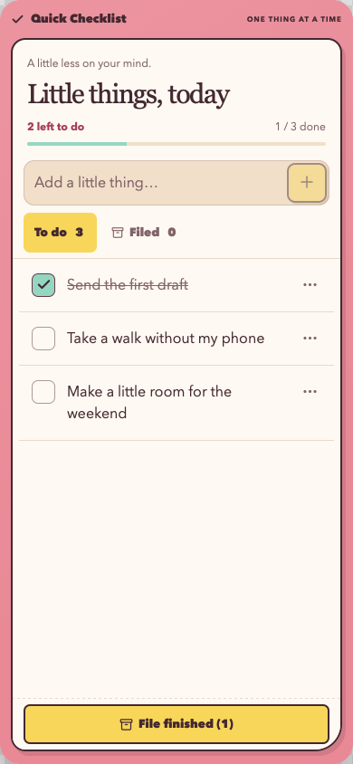
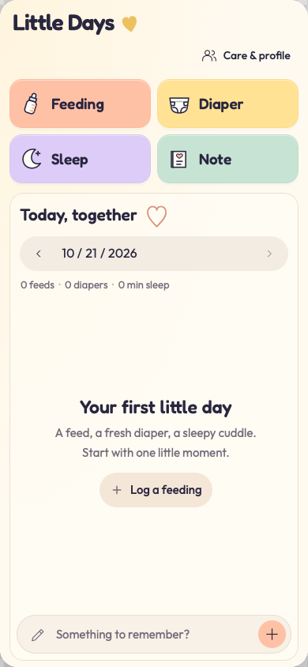
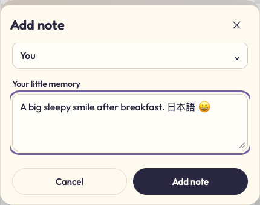

# Portrait mobile editors

Quick Checklist and Little Days have compact editor layouts. The iPhone host now
fits document content within navigation, home-indicator and keyboard safe areas,
provides a native keyboard-dismiss action, and disables page zoom. The current
phone app is portrait-only. Existing documents receive the shared host behavior;
updated authored layouts belong to updated templates and new documents.

## Visual review

The images below are WebKit `slop dev` previews, not physical-iPhone screenshots.
Both editors were reviewed at 320, 390 and 430 CSS pixels, plus their authored Mac
sizes. Review covered task entry and menus, care logging, profile edits, caregiver
creation, nested sheets, text containing Japanese/emoji, and Preview/Icon views.
Quick Checklist’s small, medium and large widget compositions were also reviewed.
The short sheet uses a simulated 340px editor height; it does not simulate a native
keyboard. In that simulated height the sticky submit/cancel controls stay reachable
below the focused textarea; this is not native-keyboard validation.

## Verification

- `bun run verify` passed: contracts, types, SDK, CLI, rendering and packed artifacts.
- The shared mobile focus regression failed before the helper was installed and
  passed afterward. It uses the existing development-host infrastructure fixture,
  with a focused field displaced by reflow in a nested scroller.
- Both templates built through the native acceptance/capture path. Editor layouts
  and static views retain their own compositions; document schemas and markers did
  not change.
- Both templates exported PNG and PDF successfully with supported-font content.
  Little Days included feeding, diaper, sleep and a long multiline memory; its
  one-page PDF was rendered back to PNG and visually inspected.
- On the iPhone 17 / iOS 27 simulator, the updated owner/page round-trip test and
  keyboard UI test passed. The UI test checks stable scale after input focus and
  pinch, native Done dismissal without leaving the document or losing text, and
  portrait remaining locked when the device rotates.
- The keyboard UI query uses a native page identifier and direct text-view lookup
  to avoid the simulator’s inconsistent WebView accessibility classification.
- `bun run verify --native` passed: Swift integration and complete frozen native
  compatibility replay, in addition to the affected static checks.

## Limits

No physical iPhone was connected for this review, and no iOS 26 simulator was
installed. The available iOS 27 simulator has a WebKit accessibility classification
mismatch that also affected the pre-change editor; the final UI test avoids that
classification and passes. Simulator results do not qualify a physical iPhone or
the supported minimum iOS 26 runtime.

Japanese and emoji were retained during editor entry. The existing PDF renderer
refuses Japanese text when the slop has no registered font covering those glyphs;
this change does not add a CJK font. Supported-font PNG/PDF output is checked
separately. Native keyboard animation, VoiceOver, and hardware-keyboard behavior
still require a physical-iPhone review.
